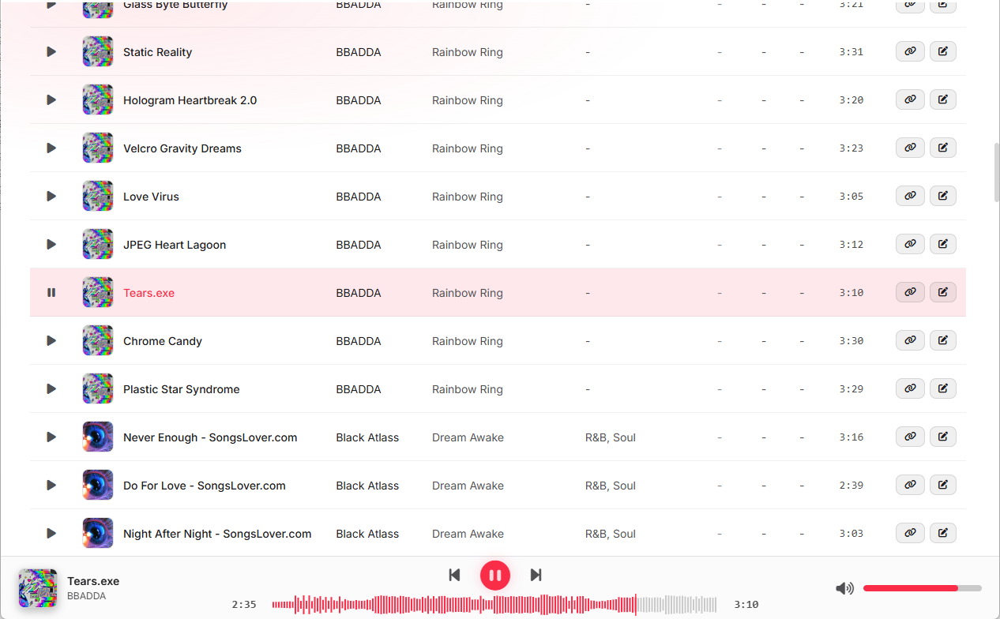
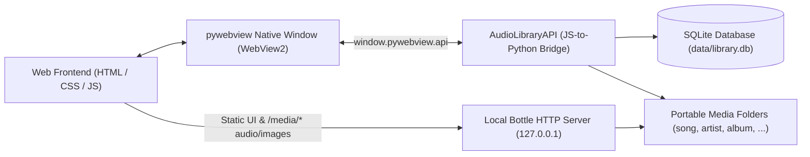

# Audio Library Manager

A lightweight, portable, offline desktop application for managing local audio libraries, musical metadata (BPM, key, scale, genres, albums, multi-alias artists), and playback — built with **Python**, **SQLite**, **Bottle**, and **pywebview** (native WebView2).




---

## Features

- **Portable Offline Library**: Point the app at any local directory to initialize a self-contained folder hierarchy (`song/`, `artist/`, `album/`, `samplepack/`, `looppack/`, `mixtape/`, `stem/`, `data/library.db`).
- **Built-in Audio Player**: Stream local MP3, WAV, FLAC, and OGG tracks directly from the library with play/pause, previous/next queue navigation, seek bar, volume control, and album artwork display.
- **Rich Musical Metadata**: Track tempo (BPM), musical key & scale, release date, track numbers, main & featured artists, localized artist aliases, and hierarchical genres.
- **Dynamic Entity Resolution**: Import songs and type new artist, album, or genre names inline — missing entities and their asset folders are created automatically.
- **Multilingual Filesystem-Safe Slug Engine**: Converts English, Vietnamese (`đ`/`Đ` and diacritics), Cyrillic/Russian (transliteration), and CJK (Unicode hex encoding) names into deterministic ASCII slugs (`[A-Za-z0-9_]`) with automatic collision resolution.
- **Real-Time Search & Filtering**: Filter the song catalog by title/artist query, genre, musical key, and scale.
- **Native Desktop UX**: Runs inside a native OS WebView window with a dark glassmorphism interface and console-less Windows launch (`app.pyw`).

---

## Architecture



### Portable Library Layout

When a user selects a library root folder, the application initializes:

```text
<library-root>/
├── data/
│   └── library.db          # Normalized 26-table SQLite database
├── song/                   # Flat audio file storage with unique slugs
├── artist/<artist-slug>/   # Artist avatars and related assets
├── album/<album-slug>/     # Album covers and related assets
├── samplepack/             # Sample pack directories
├── looppack/               # Loop pack directories
├── mixtape/                # Mixtape assets
└── stem/                   # Stem track folders
```

---

## Project Structure

```text
audio-library/
├── app.pyw                         # Windows console-less GUI launcher
├── main.py                         # Cross-platform CLI launcher
├── requirements.txt                # Runtime Python dependencies
├── LICENSE                         # MIT License
├── src/
│   └── audio_library/
│       ├── __init__.py
│       ├── app.py                  # Bottle server & pywebview bootstrap
│       ├── api.py                  # AudioLibraryAPI bridge & CRUD logic
│       ├── database.py             # SQLite schema & default seed data
│       └── slug_engine.py          # Multilingual slug & collision engine
├── web/
│   ├── index.html                  # Application layout & modals
│   ├── css/
│   │   └── style.css               # Dark glassmorphism theme
│   └── js/
│       └── app.js                  # Frontend state, filters, & audio player
└── tests/
    ├── test_slug_engine.py         # Slug transliteration & collision tests
    ├── test_database.py            # Schema, FK, & seed data tests
    └── test_api.py                 # End-to-end API & audio import tests
```

---

## Getting Started

### Prerequisites

- **Python 3.10+** (tested on Python 3.14)
- **Windows** with Microsoft Edge WebView2 Runtime (pre-installed on Windows 10/11), or an equivalent WebView backend supported by `pywebview` on macOS/Linux.

### Installation

```bash
git clone <your-repo-url>
cd audio-library

python -m venv .venv
# Windows (PowerShell):
.\.venv\Scripts\Activate.ps1
# macOS / Linux:
# source .venv/bin/activate

pip install -r requirements.txt
```

### Running the Application

- **From terminal (cross-platform):**
  ```bash
  python main.py
  ```
- **Console-less launch on Windows:**
  Double-click `app.pyw` or run:
  ```bash
  pythonw app.pyw
  ```

On first launch, click **Select Directory** to choose or create your local audio library root. The chosen path is stored locally in `app_settings.json` (gitignored).

---

## Running Tests

The test suite uses Python's built-in `unittest` framework and runs completely offline against temporary directories (no GUI required):

```bash
python -m unittest discover -s tests -v
```

---

## Database Highlights

The SQLite schema (`src/audio_library/database.py`) enforces `PRAGMA foreign_keys = ON` and ships with 26 normalized tables covering:

- **Core catalog**: `songs`, `artists`, `artist_names`, `albums`, `genres` (hierarchical via `sub_genre_of`), `moods`, `countries`, `keys`, `scales`
- **Relationships**: `song_artists` (main vs. featured), `song_genres`, `album_songs`
- **Extended production entities**: `mixtapes`, `playlists`, `sample_packs`, `samples`, `loop_packs`, `loops`, `stems`, `stem_files`, and `config`

---

## Roadmap

- UI views for Mixtapes, Playlists, Sample Packs, Loop Packs, and Stems

---

## License

This project is licensed under the [MIT License](LICENSE).
